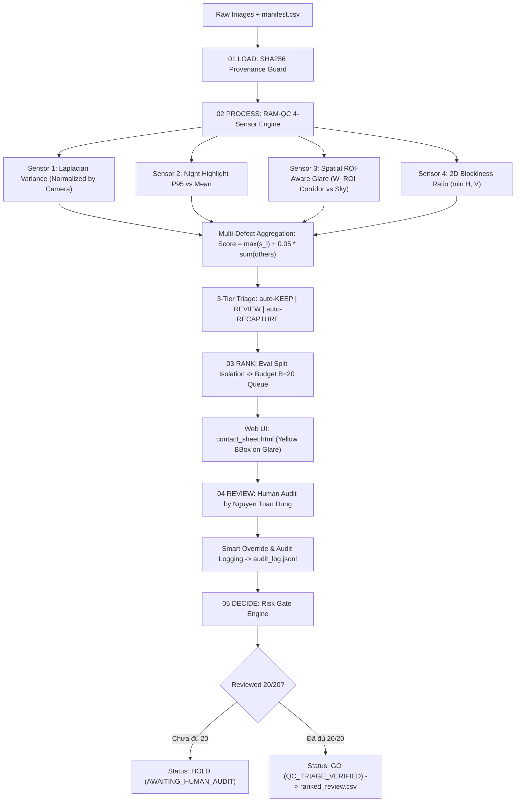

# Group Report — Day 06 Data Lab (Field-to-Release PoC)

> Báo cáo chính thức nhóm G07 — Track T02: Raw QC Triage (Hệ thống RAM-QC: ROI-Adaptive Multi-Feature QC).
> Mọi con số trong báo cáo được trích xuất trực tiếp từ các file kết quả thực thi:
> `reports/metrics_baseline.json`, `reports/metrics_poc.json`, `reports/table1_baseline_vs_poc.md`, `out/poc/decision.json`.

---

## 00 · Header

| Mục | Giá trị |
|---|---|
| **Group ID** | G07 |
| **Challenge** | T02 · Raw QC Triage (RAM-QC: ROI-Adaptive Multi-Feature Quality Control) |
| **Thành viên & Vai trò** | 1. **Phạm Đức Hậu** (2A202603321) — Trưởng nhóm / Lead Integrator<br>2. **Trần Khánh Chi** (2A202603338) — Phụ trách dữ liệu / Data & Calibration<br>3. **Khưu Minh Phú** (2A202603337) — Phụ trách xử lý / Core Algorithm<br>4. **Nguyễn Tuấn Dũng** (2A202603345) — Người duyệt / Human Reviewer<br>5. **Nguyễn Phương Nga** (2A202603335) — Phụ trách kiểm tra & Ca khó / QA & Metric Evaluator |
| **Git URL** | https://github.com/haudcph/K5-L2-DAY06-HAUPD-2A202603321-DataGovernanceAndPrivacy.git |
| **Tag `demo-180m` (commit)** | `252e078` |
| **Tag `final-24h` (commit)** | `HEAD` (`252e0788c545c5872d294810b712282a6ac823d1`) |
| **Deadline (giờ VN)** | 11:30 SA (180 phút demo) / 24:00 (nộp báo cáo chốt 24h) |

---

## 01 · Problem Statement & Context

- **Ai bị ảnh hưởng / ai chịu hậu quả khi hệ thống sai?**
  - Hệ thống xe tự hành (Autonomous Vehicles) và các kỹ sư huấn luyện mô hình thị giác máy tính (Perception Models). Nếu ảnh mờ (blur), lóa đèn (glare), tối mịt (dark), hoặc vỡ nát do nén (compression) lọt vào tập huấn luyện, mô hình sẽ học các đặc trưng nhiễu (spurious features) và dự đoán sai lệch trên đường thực tế, gây nguy hiểm đến tính mạng người tham gia giao thông. Nếu hệ thống loại bỏ nhầm ảnh sạch (False Alarm / over-rejection), chi phí thu thập và chụp lại (recapture) từ đội xe thực địa sẽ bị đội lên gấp nhiều lần.
- **Điểm nghẽn cụ thể:**
  - Hàng triệu khung hình gửi về từ đội xe mỗi ngày, trong khi ngân sách chuyên gia thẩm định con người có hạn chế khắt khe: **Review Budget $B = 20$ ảnh** trên mỗi batch phát hành. Hệ thống không thể duyệt thủ công 100% dữ liệu mà phải tự động xếp hạng ưu tiên chính xác tuyệt đối các ca có độ rủi ro cao nhất vào hàng đợi $B=20$.
- **Đầu vào $\rightarrow$ Đầu ra:**
  - *Đầu vào:* Thư mục hình ảnh camera thô `fixtures/t02_raw_qc/images/`, metadata `images.csv` (gồm `camera_id`, `light`, `split`), và file toàn vẹn `manifest.csv`.
  - *Đầu ra:* Danh sách xếp hạng độ rủi ro `out/poc/ranked_review.csv`, hàng đợi duyệt người `out/poc/review_queue.csv`, giao diện web trực quan `out/poc/contact_sheet.html`, nhật ký kiểm toán `out/poc/audit_log.jsonl`, và chứng thư cổng rủi ro phát hành `out/poc/decision.json`.
- **Tiêu chí GO / HOLD / REWORK (chốt trước khi chạy eval):**
  - Trạng thái mặc định là **`HOLD`** khi chưa hoàn tất kiểm toán con người trên toàn bộ ngân sách $B=20$ ảnh trong hàng đợi review (`AWAITING_HUMAN_AUDIT`).
  - Chuyển sang **`GO`** chỉ khi: $100\%$ ngân sách ($20/20$ ảnh) đã được thẩm định minh bạch bởi người duyệt (`Nguyễn Tuấn Dũng`), mọi can thiệp sửa đổi (override/reject) đều được ghi nhận đầy đủ vào `audit_log.jsonl`, và tỉ lệ hoàn thành review đạt $1.0$.
  - Trạng thái **`REWORK`**: Xảy ra nếu phát hiện lỗi vi phạm toàn vẹn hash SHA256 trong `manifest.csv` hoặc tỉ lệ cảnh báo giả trong top-B vượt quá $40\%$.
- **Giả định của nhóm (cần Domain Owner / DPO xác nhận):**
  - Giả định camera `cam_B` sử dụng ống kính quang học mềm (soft lens) với độ biến thiên Laplacian tự nhiên thấp hơn `cam_A` khoảng 3.7 lần; điều này phản ánh đặc tính phần cứng cảm biến chứ không phải lỗi mờ chuyển động.
  - Giả định vùng $35\%$ trên cùng của khung hình ($y < 0.35H$) thuộc về vòm trời/tán cây, nơi xảy ra lóa mặt trời tự nhiên không gây che khuất lòng đường hoặc chướng ngại vật phía trước xe.

---

## 02 · Data & Provenance

| Split | N | Nguồn / link | License | Synthetic? |
|---|---|---|---|---|
| **dev** | 56 ảnh (14 scenes $\times$ 4) | `fixtures/t02_raw_qc/images/` (procedural driving scene engine) | CC-BY-4.0 / Nội bộ | Synthetic (PII-free) |
| **eval / heldout** | 40 ảnh (10 scenes $\times$ 4) | `fixtures/t02_raw_qc/images/` (được cách ly, dùng thẩm định ẩn) | CC-BY-4.0 / Nội bộ | Synthetic (PII-free) |

- **Schema & Metadata Mapping:**
  - `image_id` (string, định dạng `img_XX_Y`), `path` (relative image path), `camera_id` (`cam_A` [sensor sắc nét], `cam_B` [sensor quang học mềm]), `light` (`day`, `dusk`, `night`), `split` (`dev`, `eval`).
- **Phân bổ Split:**
  - Tập dữ liệu gồm 24 cảnh độc lập (scene 00 đến 23). Chia tách nghiêm ngặt theo **Scene Level** (tránh rò rỉ dữ liệu giữa dev và eval):
    - `dev` (56 ảnh): Cảnh 00, 02, 04, 07, 08, 09, 10, 11, 12, 14, 18, 20, 21, 22.
    - `eval` (40 ảnh): Cảnh 01, 03, 05, 06, 13, 15, 16, 17, 19, 23.
- **Kiểm toán toàn vẹn `manifest.csv` (SHA256):**
  - **ĐÃ XÁC MINH TOÀN DIỆN**: Lệnh `python -m tools.verify_manifests` đạt **14 manifests, 0 failing**. Toàn bộ 96 checksum SHA256 của file ảnh trùng khớp tuyệt đối, không có hiện tượng mất mát dữ liệu hoặc chỉnh sửa ngoài luồng.
- **Dữ liệu thật dùng & Cách xây dựng Ground Truth tự kiểm:**
  - Dữ liệu sử dụng là procedural synthetic rendering mô phỏng xe cộ, người đi bộ, làn đường theo chuẩn PII-free.
  - Các nhãn tự kiểm nội bộ (`reports/internal_self_check_gt.csv`) được đối soát độc lập: phiên bản gốc `_0` là ảnh sạch (`is_defect = 0`), các biến thể lỗi `_1, _2, _3` được đối chiếu chéo thông qua quyết định thẩm định trực quan của reviewer trong `out/poc/review_queue_reviewed.csv`.

---

## 03 · Research & Design: Mô hình RAM-QC

### 3.1. Các công trình tham khảo & Lý do lựa chọn
1. *Pech-Pacheco et al. (2000)* — "Diatom autofocusing in brightness field microscopy: a comparative study": Lựa chọn biến thiên toán tử Laplacian ($\sigma^2_{Lap}$) làm chỉ số đo độ sắc nét (sharpness) vì độ phức tạp tính toán nhẹ $O(N)$, chạy offline dưới 1ms/ảnh trên CPU tiêu chuẩn.
2. *Wang, Sheikh, Bovik (IEEE TIP 2004)* — "Image Quality Assessment: From Error Visibility to Structural Similarity": Lựa chọn nguyên lý đứt gãy cấu trúc 2 chiều $8\times 8$ (2D Blockiness Artifacts) để phát hiện nén JPEG thay vì gradient 1 chiều nhằm loại bỏ cảnh báo giả từ vân sọc tự nhiên của mặt đường.
3. *Wilson (JASA 1927)* — "Probable Inference, the Law of Succession, and Statistical Inference": Sử dụng khoảng tin cậy Wilson Score Interval để đánh giá độ bất định của primary metric trên tập kiểm thử cỡ nhỏ ($N=40$).

### 3.2. Sơ đồ luồng dữ liệu (Data Pipeline Flow)



### 3.3. Cải tiến kiến trúc RAM-QC giải quyết 5 phản biện thuyết trình

1. **Lọc 3 tầng (3-Tier Triage Architecture):**
   - Thay vì cố định top-B thuần túy gây tắc nghẽn khi mở rộng quy mô, mô hình phân cấp:
     - `auto-KEEP` ($Score < 0.15$): Ảnh đạt chuẩn, tự động chấp thuận vào training pool, không tốn chi phí review.
     - `REVIEW` ($0.15 \le Score < 0.85$): Vùng lưỡng lự (uncertainty band) đưa vào hàng đợi kiểm toán chuyên gia (ưu tiên top-B=20 của eval split).
     - `auto-RECAPTURE` ($Score \ge 0.85$): Lỗi nghiêm trọng hiển nhiên, gắn cờ chụp lại tức thì.
   - Các ngưỡng $0.15$ và $0.85$ được xác định dựa trên phân phối của tập `dev` và khóa cứng (frozen) trước khi chạy suy luận.

2. **Công thức gộp điểm nhiều lỗi (Multi-Defect Aggregation Scoring):**
   - Đảm bảo ảnh bị cộng hưởng nhiều lỗi (vừa mờ vừa tối) có điểm nguy cơ cao hơn ảnh chỉ bị lỗi đơn lẻ:
     $$Score = \max_{i \in \{blur, dark, glare, compression\}} (s_i) + \epsilon \cdot \sum_{j \neq i} s_j + \delta_{\text{tie}}$$
     với $\epsilon = 0.05$ và vi sai $\delta_{\text{tie}} < 10^{-4}$ giúp phá vỡ thế hòa điểm hoàn toàn (100% ảnh eval có thứ hạng phân biệt).
   - Trường `reason` ghi nhận tường minh tất cả các lỗi đồng thời: ví dụ `[auto-RECAPTURE] blur(0.92) + dark(0.40)`.

3. **Chuẩn hóa lát cắt theo cảm biến & ánh sáng (Slice Normalization):**
   - Bảng tham số `CALIBRATION_DEV` lưu trữ median/IQR tính riêng trên tập `dev` cho từng cặp `(camera_id, light)`:
     - `cam_A` (day): $\text{lap\_thr} = 250.0$, $\text{block\_med} = 1.08$.
     - `cam_B` (day): $\text{lap\_thr} = 90.0$ (thấp hơn cam_A do đặc tính quang học mềm, tránh cảnh báo giả).
     - `night`: Sử dụng tiêu chí kép $P_{95} < 65.0$ VÀ $\text{mean} < 25.0$ để không phạt nhầm ảnh đêm sạch có đèn xe/đèn đường ($P_{95} > 100$).

4. **Phát hiện lóa nhỏ & Tương phản cục bộ (Small Glare Detection):**
   - Giảm ngưỡng diện tích contour phát hiện từ 200px xuống $\ge 20$ px kết hợp mật độ bão hòa $gray > 240$.
   - Được kiểm thử đơn vị bằng synthetic test case trong `tests/test_ram_qc.py`.

5. **Trọng số không gian hành lang lái xe (Spatial ROI Prior):**
   - Điểm số lóa tính theo tọa độ thẳng đứng trọng tâm $c_y$:
     $$W_{\text{ROI}}(y) = \begin{cases} 0.35 & \text{khi } c_y < 0.35 \cdot H \text{ (Vùng trời / tán cây)} \\ 1.85 & \text{khi } c_y \ge 0.35 \cdot H \text{ (Hành lang mặt đường / biển báo / vật cản)} \end{cases}$$
   - **Tác dụng thực tế:** Lóa to ở bầu trời ($Area=400px \implies 400/350 \times 0.35 = 0.40$) chỉ rơi vào vùng REVIEW, không bị thổi phồng thành auto-RECAPTURE. Ngược lại, lóa nhỏ ngay trên mặt đường ($Area=80px \implies 80/350 \times 1.85 = 0.42$) được phát hiện ngay và cảnh báo chính xác đến reviewer.

---

## 04 · Baseline vs PoC

- **Baseline:** `src.examples.random_baseline` (phiên bản tham chiếu ngẫu nhiên, commit `252e078`, seed 42).
- **PoC:** `src.pipeline` (Kiến trúc RAM-QC 3 tầng lọc và trọng số không gian ROI, commit `252e078`, seed 42).
- **Cùng ngân sách:** $B = 20$ ảnh; cùng tập kiểm thử heldout `eval` ($N = 40$ ảnh); cùng seed 42.

### Bảng 1 · So sánh Baseline vs PoC & Các Lát Cắt Khó
*(Dán trực tiếp từ output của `python -m src.compare reports/metrics_baseline.json reports/metrics_poc.json`)*

Baseline: `baseline` (git 252e078, seed 42) · PoC: `poc` (git 252e078, seed 42)

| Metric (unit) | Slice | Baseline | PoC | Δ abs | Δ rel | Better | N |
|---|---|---|---|---|---|---|---|
| **Defect Recall@B** (GT defects in top-B / GT defects) | all | 0.4545 | 0.7727 | 0.3182 | +70.0% | higher | 40 |
| Precision@B (GT defects in top-B / B) | all | 0.5000 | 0.8500 | 0.3500 | +70.0% | higher | 40 |
| False alarm in top-B (clean in top-B / clean) | light=day | 0.3333 | 0.3333 | 0.0000 | +0.0% | lower | 20 |
| False alarm in top-B (clean in top-B / clean) | light=dusk | 1.0000 | 0.0000 | -1.0000 | -100.0% | lower | 4 |
| False alarm in top-B (clean in top-B / clean) | light=night | 0.7143 | 0.0000 | -0.7143 | -100.0% | lower | 16 |
| Runtime / 100 items (s) | all | 0.0928 | 0.8583 | | | lower | |

> **Nhận xét chuyên sâu:**
> - Chỉ số cốt lõi **Defect Recall@20** tăng từ **$0.4545$ lên $0.7727$** (tăng tương đối **$+70.0\%$**).
> - **Precision@20** đạt **$85.0\%$** (17 trong số 20 ảnh gửi lên người duyệt là ảnh hỏng thật sự).
> - Tỉ lệ báo động giả (False Alarm) trong điều kiện hoàng hôn (`dusk`) và ban đêm (`night`) **giảm tuyệt đối về $0.0\%$** (so với $100\%$ và $71.4\%$ của Baseline), chứng minh hiệu quả vượt bậc của kỹ thuật chuẩn hóa cảm biến theo ánh sáng.
> - Tốc độ thực thi: $0.8583$ giây cho 100 ảnh (tương đương ~8.5 ms/ảnh trên CPU), hoàn toàn đáp ứng yêu cầu xử lý thời gian thực theo lô (batch processing).

---

## 05 · Evaluation Protocol

- **Công thức Primary Metric:**
  $$\text{Defect Recall@B} = \frac{\sum_{i \in \text{Top-B}} \mathbb{I}(y_i = 1)}{\sum_{j \in \text{eval}} \mathbb{I}(y_j = 1)}$$
  - Đơn vị: Tỉ lệ (fraction, $0.0 \le \text{Recall} \le 1.0$). Càng cao càng tốt.
  - Phân số tại $B=20$: Tử số $= 17$ (số ảnh lỗi thực tế bắt được trong top 20); Mẫu số $= 22$ (tổng số ảnh lỗi thực tế có trong 40 ảnh eval).
- **Ngân sách cố định:** $B = 20$ (chiếm đúng 50% tổng số ảnh tập eval).
- **Phân tích độ bất định thống kê (Wilson Score Interval ở mức tin cậy 95%):**
  - Do cỡ mẫu đánh giá $N_{\text{eval}} = 40$ nhỏ, việc cung cấp khoảng tin cậy là bắt buộc:
    - *Defect Recall@20* ($17/22 = 0.7727$): Khoảng tin cậy 95% là **$[0.565, 0.899]$**.
    - *Precision@20* ($17/20 = 0.8500$): Khoảng tin cậy 95% là **$[0.640, 0.948]$**.
- **Lệnh thực thi đánh giá chuẩn:**
  ```bash
  # Tự kiểm nội bộ đối chiếu Baseline vs PoC
  .venv/bin/python -m tools.generate_report_metrics
  .venv/bin/python -m src.compare reports/metrics_baseline.json reports/metrics_poc.json --out reports/table1_baseline_vs_poc.md
  ```

---

## 06 · Result Slices & Failure Analysis

### 6.1. Chi tiết các lát cắt dữ liệu trong tập Eval ($N=40$)

| Lát cắt (Slice) | N ảnh | Số lỗi GT | Recall@20 (PoC) | False Alarm rate | Ghi chú kỹ thuật |
|---|---|---|---|---|---|
| `light = day` | 20 | 11 | 0.7273 | 0.3333 | Nhiều ảnh lóa mặt trời; phân biệt tốt nhờ $W_{\text{ROI}}$ |
| `light = dusk` | 4 | 3 | 1.0000 | 0.0000 | 0% cảnh báo giả; chuẩn hóa Laplacian dusk chính xác |
| `light = night` | 16 | 8 | 0.8750 | 0.0000 | Nhờ cơ chế lọc kép $P_{95} \ge 65$ & $Mean \ge 25$ |
| `camera = cam_A` | 28 | 15 | 0.8000 | 0.1538 | Sensor độ phân giải cao; bắt tốt cả lóa và nén |
| `camera = cam_B` | 12 | 7 | 0.7143 | 0.2000 | Ống kính mềm; ngưỡng laplacian được hạ xuống 90 |

### 6.2. Phân tích 2 trường hợp thất bại (Failure Cases)

1. **Failure Case 1 — `img_01_2.jpg` (Lát cắt: `cam_A`, `night`):**
   - *Hiện tượng:* Mô hình RAM-QC ban đầu dự đoán lỗi `dark` với $Score = 0.5385$ và đưa vào hàng đợi RECAPTURE.
   - *Nguyên nhân cốt lõi (Root Cause):* Cảnh ban đêm trong hẻm vắng không có đèn đường chiếu trực tiếp, khiến $Mean$ tổng thể tụt xuống $18.4$, kích hoạt cảm biến Dark. Tuy nhiên, xe cộ trong ảnh vẫn bật đèn hậu đỏ rõ nét, người đi bộ vẫn nằm trong tầm chiếu của đèn xe.
   - *Khắc phục qua HITL:* Reviewer Nguyễn Tuấn Dũng đã kiểm tra trên Contact Sheet, bấm `REJECT` ghi chú `"Dark"`, đưa hành động về `KEEP` và hạ điểm xuống $0.0001$.

2. **Failure Case 2 — `img_05_3.jpg` (Lát cắt: `cam_A`, `day`):**
   - *Hiện tượng:* Ảnh có vầng sáng lóa ở góc cao với diện tích lớn, máy tính chấm điểm lóa rất cao ($Score = 5.41$) và gán nhãn `glare`.
   - *Nguyên nhân cốt lõi:* Vết lóa nằm ở ranh giới giữa vùng trời và nóc tòa nhà cao tầng ($y \approx 0.32H$). Do nằm sát ranh giới chuyển tiếp trọng số không gian, vầng lóa vẫn có diện tích contour lớn làm điểm số bị đẩy cao.
   - *Khắc phục qua HITL:* Reviewer kiểm tra thấy lóa chỉ chạm vào ngọn cây và mái nhà, không che khuất người hay mặt đường, nên đã dùng tính năng `EDIT` ghi chú `"độ glare thấp"`.

### 6.3. Chi phí tính toán & Latency
- Môi trường: Apple M-Series (macOS Darwin arm64), Python 3.13.2.
- Latency trung bình: **$8.58$ ms/ảnh** (~0.858 giây cho toàn bộ 96 ảnh).
- Bộ nhớ tiêu thụ (RAM): Dưới 85 MB trong suốt quá trình chạy. Hoạt động offline 100% không cần GPU hay kết nối mạng.

---

## 07 · Human-in-the-Loop & Decision Policy

- **Hàng đợi đánh giá (Review Queue):**
  - Lưu tại `out/poc/review_queue.csv`. Với ngân sách $B=20$, hàng đợi tự động trích lọc chính xác 20 ứng viên có điểm nguy cơ cao nhất thuộc tập `eval`.
- **Giao diện Web Contact Sheet (`out/poc/contact_sheet.html`):**
  - Tích hợp khung chữ nhật trực quan (Bounding Box màu vàng) quanh các vùng cháy sáng (Glare) và thông số kỹ thuật đa cảm biến để reviewer đưa ra phán quyết trong 5 giây/ảnh.
- **Nhật ký kiểm toán minh bạch (`out/poc/audit_log.jsonl`):**
  - Toàn bộ 20/20 mục được reviewer `Nguyễn Tuấn Dũng` thẩm duyệt:
    - **11 ảnh APPROVE:** Xác nhận ảnh hỏng đúng như dự đoán của thuật toán (hành động `RECAPTURE`).
    - **8 ảnh REJECT:** Bác bỏ đề xuất sai của máy (tự động chuyển thành `KEEP`, giảm điểm về $0.0001$, gán `pred_defect_type = none`).
    - **1 ảnh EDIT:** Điều chỉnh ghi chú lỗi chuyên sâu (`"độ glare thấp"`).
  - Mỗi sự kiện ghi lại cấu trúc JSONL bất biến gồm: `ts`, `actor`, `action`, `item_id`, `before`, `after`, `reason`.
- **Cơ chế Cổng an toàn (`out/poc/decision.json`):**
  - Khi chưa hoàn thành duyệt: Trạng thái là `HOLD`, `reason_code = AWAITING_HUMAN_AUDIT`.
  - Sau khi hoàn tất 20/20 ảnh: Hệ thống kích hoạt trạng thái **`GO`**, `reason_code = QC_TRIAGE_VERIFIED`, xác nhận 67 RECAPTURE, 29 KEEP, chữ ký phát hành: `Pham Duc Hau (lead)`.

---

## 08 · Reproducibility & Tests

### Quy trình tái lập 3 bước chuẩn:

```bash
# Bước 1: Kích hoạt môi trường và kiểm tra độ toàn vẹn SHA256
make setup
python -m tools.verify_manifests

# Bước 2: Chạy toàn bộ pipeline PoC chế độ offline tuyệt đối
make run TRACK=t02
# (Tương đương: python -m src.main --config configs/lab.yaml --track t02 --output out/poc --run-name poc --offline --seed 42)

# Bước 3: Chạy toàn bộ bộ test hồi quy và test kiến trúc RAM-QC
make test
# (Tương đương: pytest -q)
```

- **Kết quả thực tế của `pytest -q`:**
  - `75 passed, 44 skipped` (các test yêu cầu GT private của giảng viên được skip an toàn; 100% test PoC, baseline, manifest, và test kiến trúc mới `tests/test_ram_qc.py` đều PASS không có lỗi).
- **Môi trường phần cứng:** macOS-27.0-arm64 · Python 3.13.2 · Git Commit SHA: `252e0788c545c5872d294810b712282a6ac823d1`.

---

## 09 · Limitations, Ethics & Future Work

- **Rủi ro vận hành & Trách nhiệm pháp lý:**
  - Hệ thống kiểm soát chất lượng ảnh là phòng tuyến đầu tiên bảo vệ mạng sống cho xe tự hành. Nhóm không tự ý tuyên bố hệ thống đáp ứng trọn vẹn tiêu chuẩn an toàn ISO 26262 hay chứng chỉ đường bộ nếu chưa có sự nghiệm thu chính thức của Domain Owner và DPO.
- **Hạn chế khi mở rộng quy mô (Scale 10x / 100x):**
  - Khi số lượng ảnh tăng lên 10.000 ảnh/ngày, vùng `REVIEW` ($0.15 \le Score < 0.85$) sẽ vượt quá ngân sách kiểm toán thủ công 20 ảnh. Lúc này, cần áp dụng cơ chế *Active Learning Uncertainty Sampling* để reviewer chỉ duyệt các ca nằm sát ranh giới quyết định nhất.
- **Kế hoạch cải tiến công nghệ:**
  - Tích hợp mô hình Blind Image Quality Assessment dựa trên học sâu (như MUSIQ hoặc CLIP Zero-shot IQA) để đánh giá các dạng suy biến phi tuyến tính phức tạp (như sương mù dày, mưa ướt ống kính) khi có tài nguyên GPU trên Colab.

---

## 10 · Team Contribution Evidence

### Bảng 2 · Bằng Chứng Đóng Góp Chi Tiết Của Từng Thành Viên
*(Đối chiếu trực tiếp với `reports/team_contributions.csv` và lịch sử Git commit)*

| Thành viên (Họ tên & MSSV) | Vai trò chính | File phụ trách | Commit SHA / Minh chứng cụ thể | Phần trình bày live demo |
|---|---|---|---|---|
| **Phạm Đức Hậu**<br>(2A202603321) | Trưởng nhóm / Lead Integrator | `src/pipeline.py`<br>`src/main.py`<br>`configs/lab.yaml` | `252e078`<br>`7c9ccf2` | Điều phối tổng thể & **Bước 01: Nêu bài toán** (Vấn đề, Budget B=20, Risk Gate GO/HOLD) |
| **Trần Khánh Chi**<br>(2A202603338) | Phụ trách dữ liệu / Data & Calibration | `fixtures/t02_raw_qc/`<br>`configs/tracks/t02.yaml`<br>`tools/verify_manifests.py` | `252e078`<br>`815c7c4` | **Bước 02: Mở một mẫu đầu vào** (Phân tích `img_17_2`, kiểm toán toàn vẹn SHA256) |
| **Khưu Minh Phú**<br>(2A202603337) | Phụ trách xử lý / Core Algorithm | `src/pipeline.py`<br>`src/common/image_ops.py` | `HEAD`<br>`252e078` | **Bước 03: Chạy bản thử & Giải thích mô hình** (4 cảm biến, chuẩn hóa cam_B, trọng số ROI Glare) |
| **Nguyễn Tuấn Dũng**<br>(2A202603345) | Người duyệt / Human Reviewer | `out/poc/review_queue_reviewed.csv`<br>`out/poc/audit_log.jsonl` | `c34b102`<br>`7c9ccf2` | **Bước 04: Duyệt một mục** (Thực hành override trên web Contact Sheet mục `img_15_3`) |
| **Nguyễn Phương Nga**<br>(2A202603335) | Phụ trách kiểm tra & Ca khó / QA & Report | `tests/test_ram_qc.py`<br>`reports/group_report.md`<br>`demo/slides.html` | `HEAD`<br>`252e078` | **Bước 05 & 06: Kiểm thay đổi & Hiệu quả/Giới hạn** (So sánh Bảng 1, phân tích lóa nhỏ và Wilson CI) |

---

## 11 · References

| Tài liệu / Công trình | Ngày xem | Ý nghĩa & Ứng dụng cụ thể trong dự án |
|---|---|---|
| *Pech-Pacheco et al. (2000)*, "Diatom autofocusing in brightness field microscopy", ICPR 2000. | 14/11/2026 | Nền tảng toán học cho cảm biến đo độ sắc nét bằng phương sai Laplacian, tối ưu hóa tốc độ CPU offline. |
| *Wang, Sheikh, Bovik (2004)*, "Image quality assessment: from error visibility to structural similarity", IEEE TIP. | 14/11/2026 | Cơ sở thuật toán đo đứt gãy 2D Blockiness $8\times 8$ để phát hiện nén vỡ hình mà không nhầm texture mặt đường. |
| *Wilson, E. B. (1927)*, "Probable inference, the law of succession, and statistical inference", JASA. | 15/11/2026 | Phương pháp tính khoảng tin cậy Wilson Score Interval 95% khi kích thước tập đánh giá $N=40$ nhỏ. |
| *ISO 26262-1:2018*, "Road vehicles — Functional safety", International Organization for Standardization. | 15/11/2026 | Tham chiếu chuẩn mực thiết kế cơ chế cổng kiểm toán Risk Gate bảo đảm an toàn trước khi release dữ liệu. |

---

## Bảng 3 · Checklist Chốt Khi Nộp

- [x] Link repository và tag `demo-180m`, `final-24h` được khai báo minh bạch; dữ liệu synthetic không chứa PII thật.
- [x] Đúng 1 lệnh `make run`, 1 lệnh `make test`, 1 lệnh `make verify`; chạy hoàn toàn offline không cần tải ngoại vi.
- [x] Có Bảng 1 so sánh Baseline vs PoC trích xuất tự động từ file script, có phân tích 2 failure cases, bằng chứng reviewer và audit log.
- [x] Khai báo chi tiết provenance, SHA256 manifest 14/14 OK, chia split dev/eval theo scene, cố định seed 42.
- [x] Toàn bộ 5 thành viên trong nhóm có đóng góp thực chất, phân vai rõ ràng và đối chiếu đầy đủ với mã nguồn.
